 
&nbsp;
 

 
&nbsp;
 

## 2021-01-13, COVID-19 Time Series
# TX counties (top 15) 

 
&nbsp;
 

|  1. Harris  |  2. Dallas  |  
|  :---   |   :---   |  
|  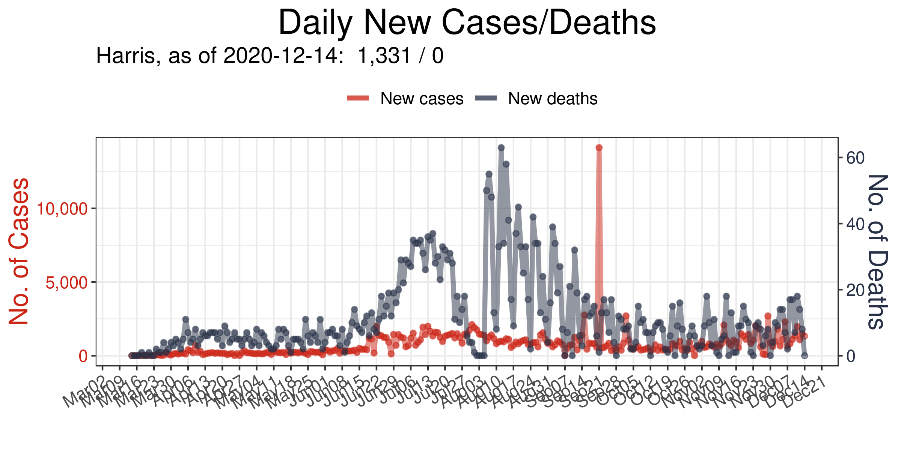  |  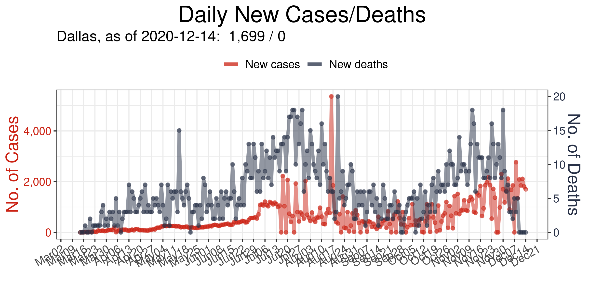  |  

|  3. Tarrant  |  4. Bexar  |  
|  :---   |   :---   |  
|  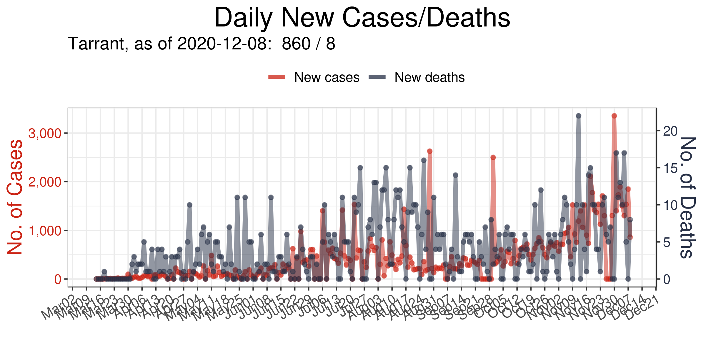  |  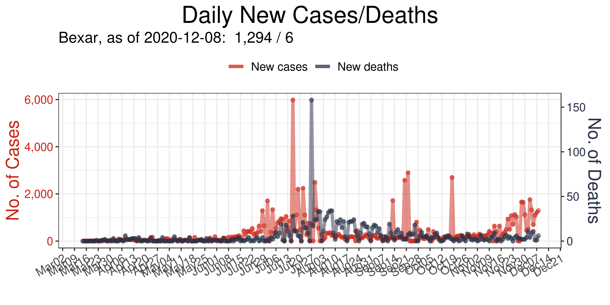  |  

|  5. El Paso  |  6. Collin  |  
|  :---   |   :---   |  
|  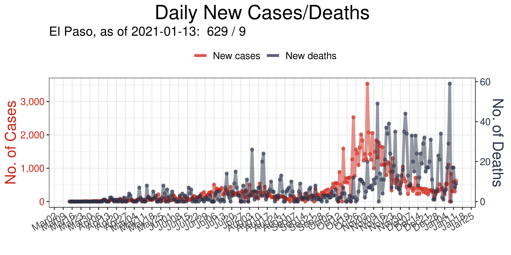  |  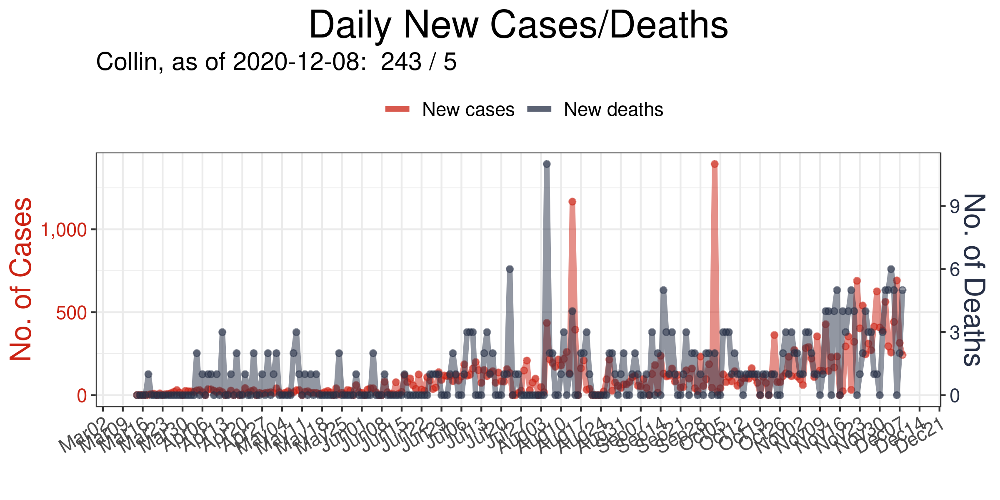  |  

|  7. Travis  |  8. Hidalgo  |  
|  :---   |   :---   |  
|  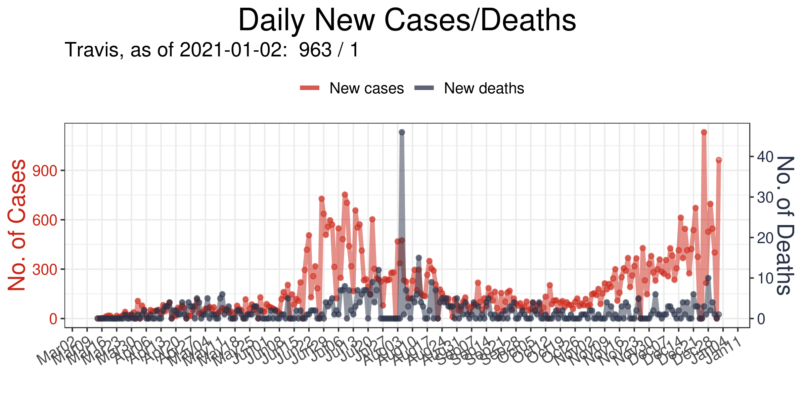  |  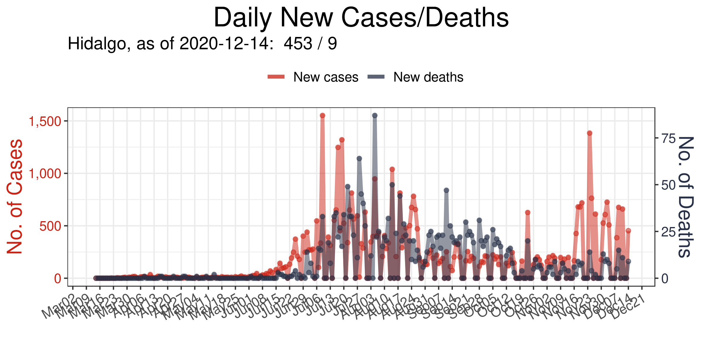  |  

|  9. Denton  |  10. Lubbock  |  
|  :---   |   :---   |  
|  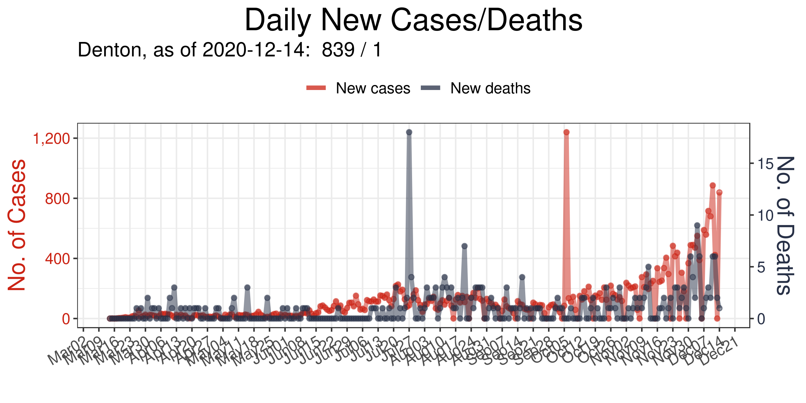  |  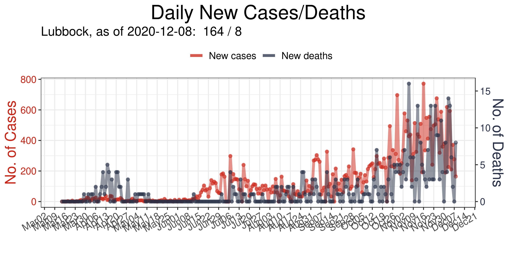  |  

|  11. Fort Bend  |  12. Montgomery  |  
|  :---   |   :---   |  
|  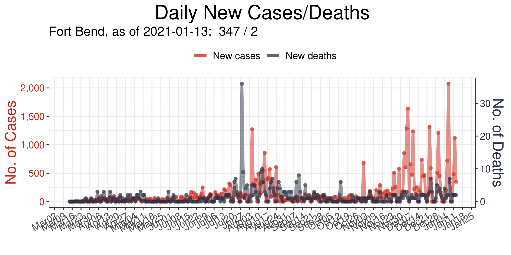  |  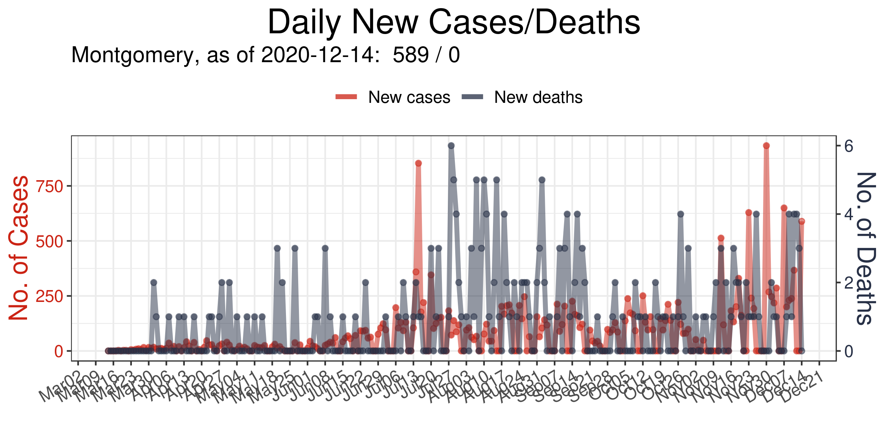  |  

|  13. Nueces  |  14. Cameron  |  
|  :---   |   :---   |  
|  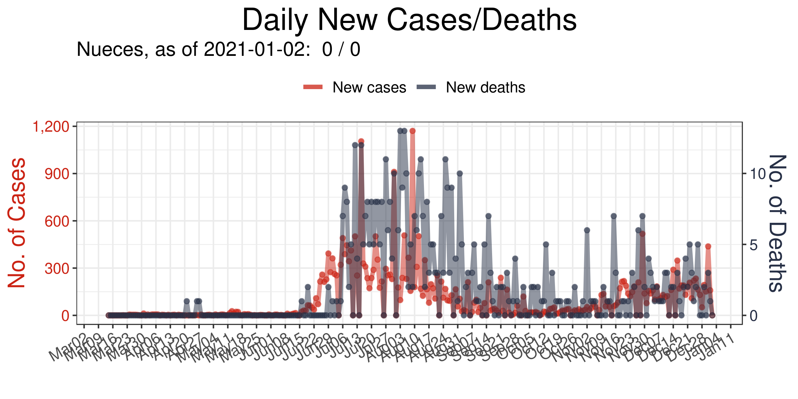  |  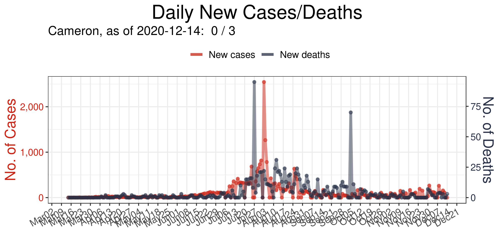  |  

|  15. Webb  |  16. NA  |  
|  :---   |   :---   |  
|  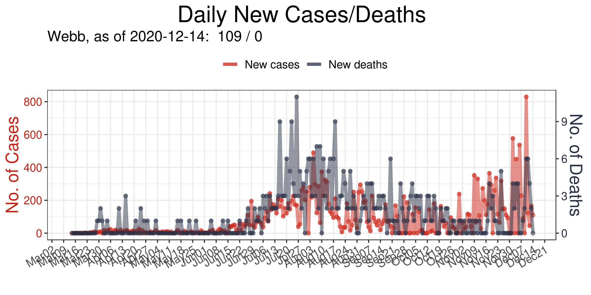 |   NA  |  

