 
&nbsp;
 

 
&nbsp;
 

## 2020-12-08, COVID-19 Time Series
# Countries (top 50)

 
&nbsp;
 

|  1. US  |  2. India  |  
|  :---   |   :---   |  
|  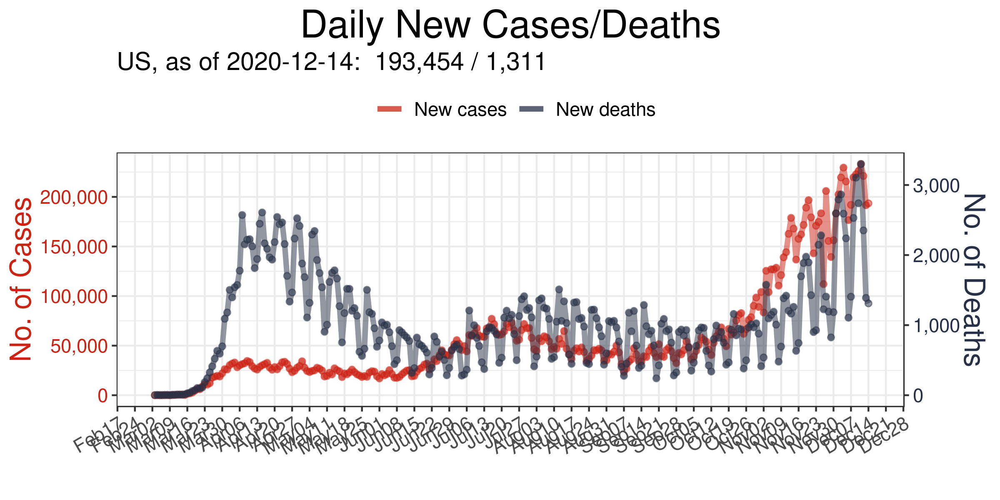  |    |  

|  3. Brazil  |  4. Russia  |  
|  :---   |   :---   |  
|    |  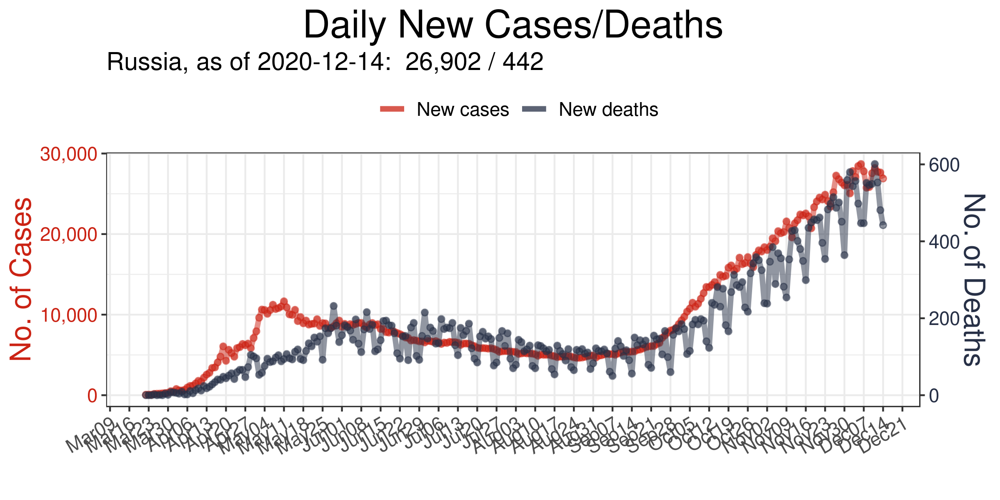  |  

|  5. France  |  6. Italy  |  
|  :---   |   :---   |  
|    |    |  

|  7. United Kingdom  |  8. Spain  |  
|  :---   |   :---   |  
|  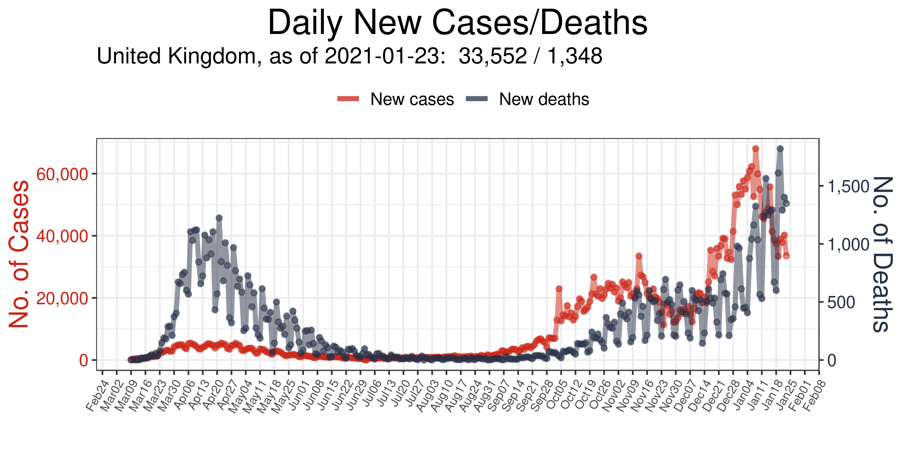  |  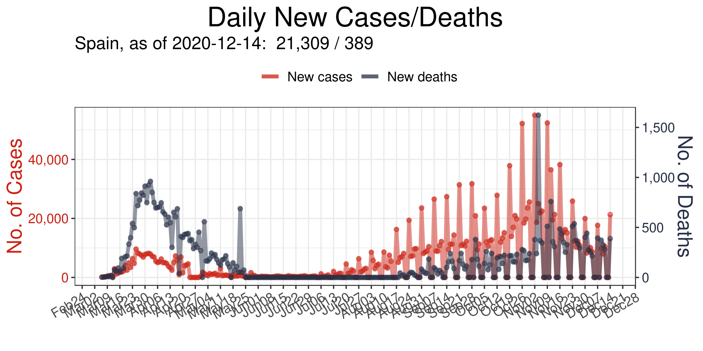  |  

|  9. Argentina  |  10. Colombia  |  
|  :---   |   :---   |  
|    |    |  

|  11. Germany  |  12. Mexico  |  
|  :---   |   :---   |  
|    |  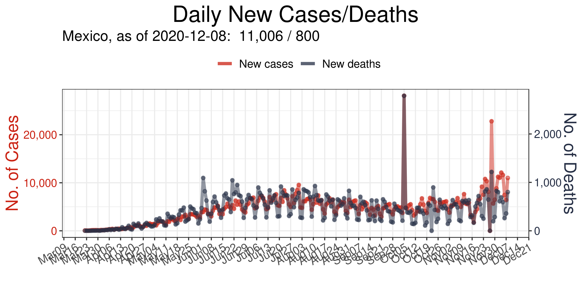  |  

|  13. Poland  |  14. Iran  |  
|  :---   |   :---   |  
|  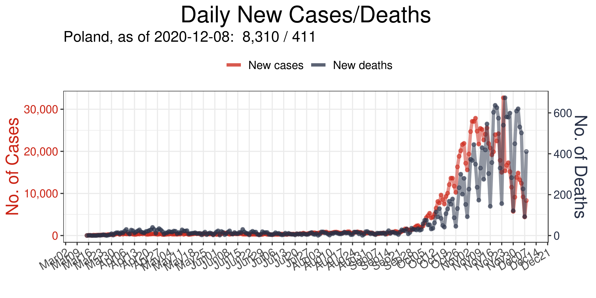  |    |  

|  15. Peru  |  16. Turkey  |  
|  :---   |   :---   |  
|    |    |  

|  17. Ukraine  |  18. South Africa  |  
|  :---   |   :---   |  
|    |  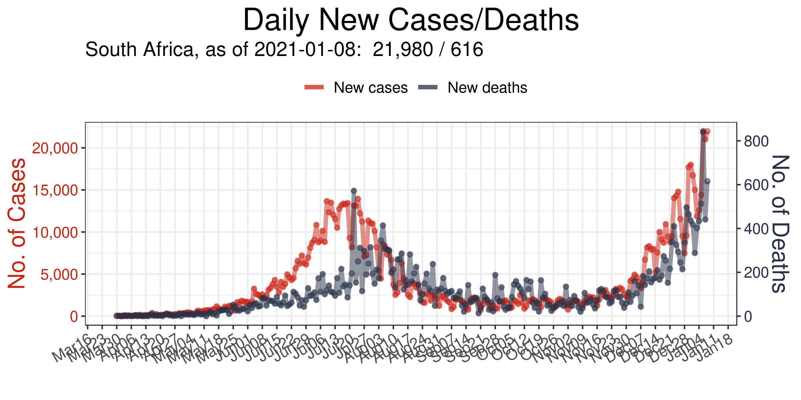  |  

|  19. Belgium  |  20. Indonesia  |  
|  :---   |   :---   |  
|    |    |  

|  21. Netherlands  |  22. Iraq  |  
|  :---   |   :---   |  
|    |    |  

|  23. Chile  |  24. Czechia  |  
|  :---   |   :---   |  
|    |    |  

|  25. Romania  |  26. Bangladesh  |  
|  :---   |   :---   |  
|    |    |  

|  27. Philippines  |  28. Canada  |  
|  :---   |   :---   |  
|    |  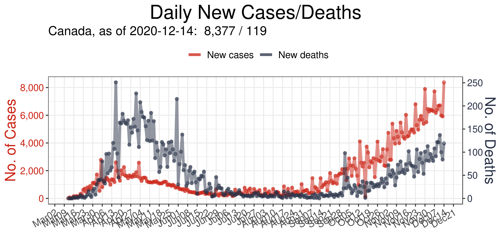  |  

|  29. Pakistan  |  30. Morocco  |  
|  :---   |   :---   |  
|    |  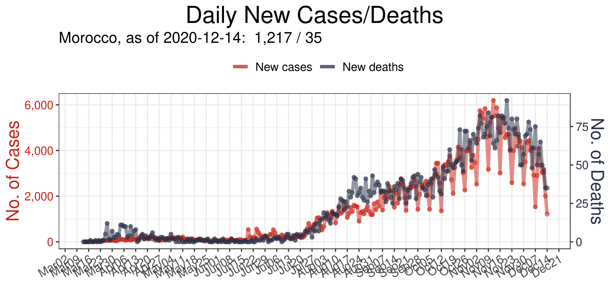  |  

|  31. Saudi Arabia  |  32. Switzerland  |  
|  :---   |   :---   |  
|    |    |  

|  33. Israel  |  34. Portugal  |  
|  :---   |   :---   |  
|  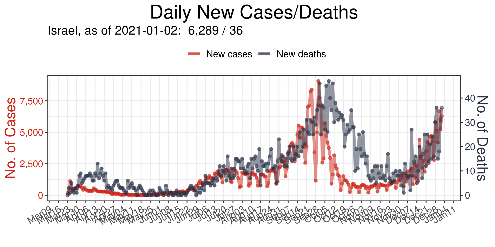  |  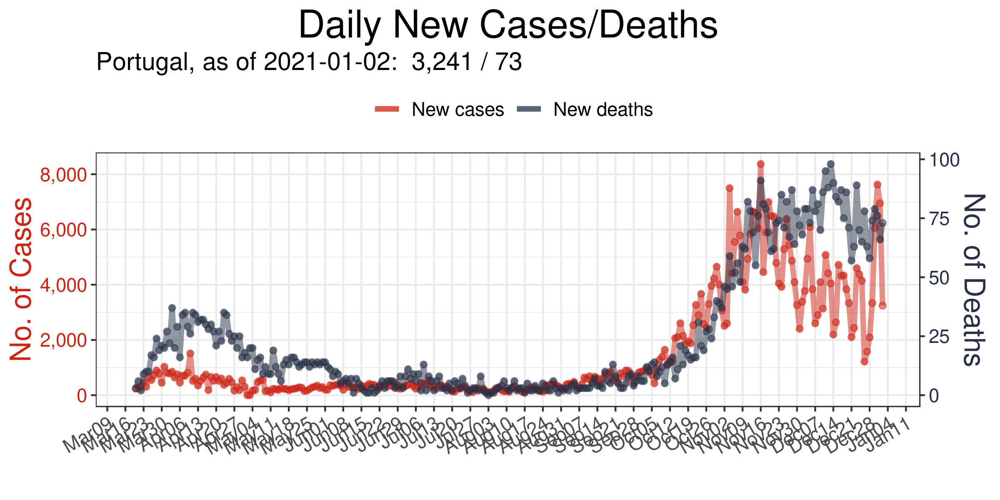  |  

|  35. Austria  |  36. Sweden  |  
|  :---   |   :---   |  
|    |    |  

|  37. Hungary  |  38. Jordan  |  
|  :---   |   :---   |  
|    |    |  

|  39. Nepal  |  40. Serbia  |  
|  :---   |   :---   |  
|    |    |  

|  41. Ecuador  |  42. Kazakhstan  |  
|  :---   |   :---   |  
|    |  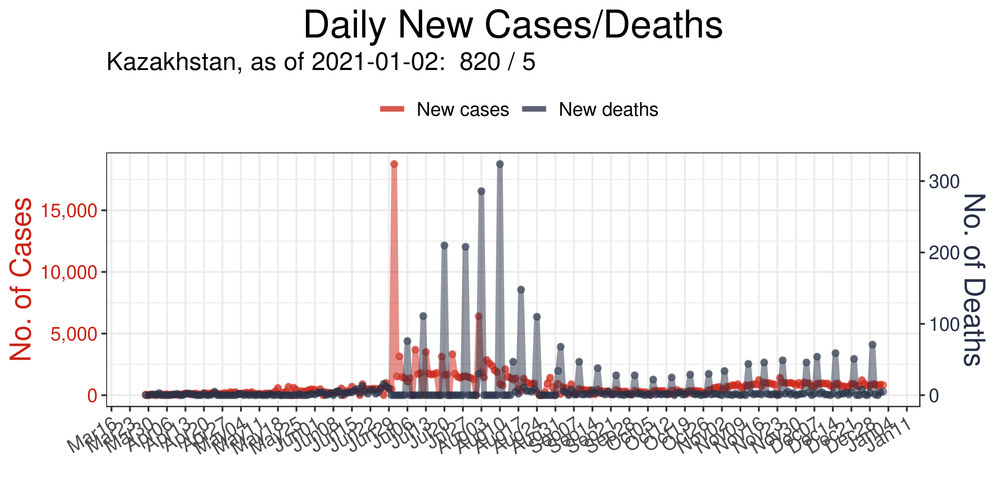  |  

|  43. Panama  |  44. United Arab Emirates  |  
|  :---   |   :---   |  
|  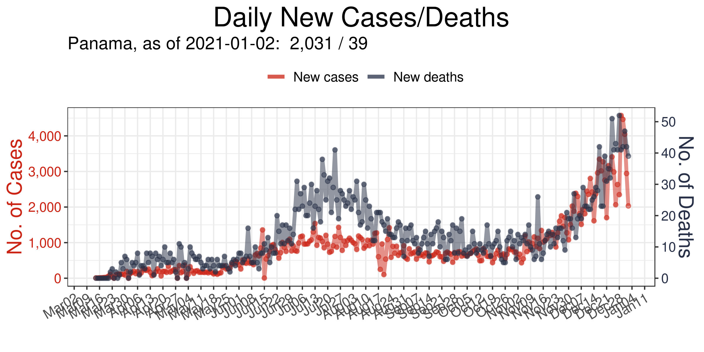  |    |  

|  45. Georgia  |  46. Bulgaria  |  
|  :---   |   :---   |  
|  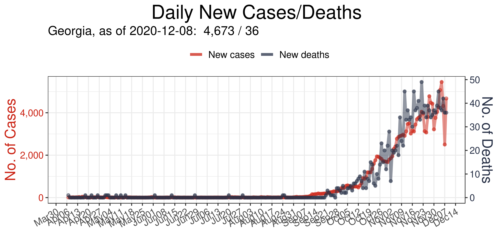  |    |  

|  47. Japan  |  48. Croatia  |  
|  :---   |   :---   |  
|    |    |  

|  49. Azerbaijan  |  50. Belarus  |  
|  :---   |   :---   |  
|    |  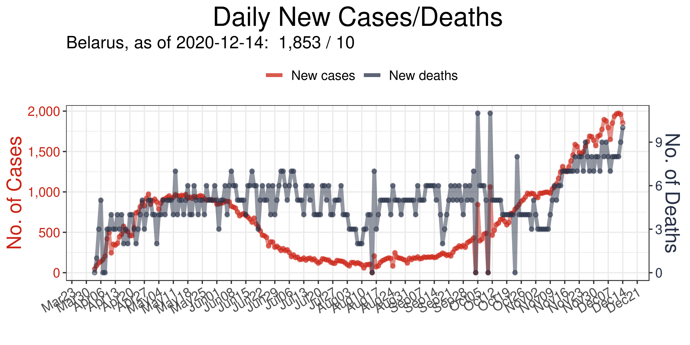  |  

Korea, South  
    

