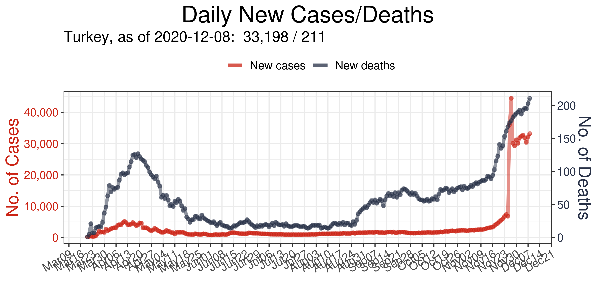
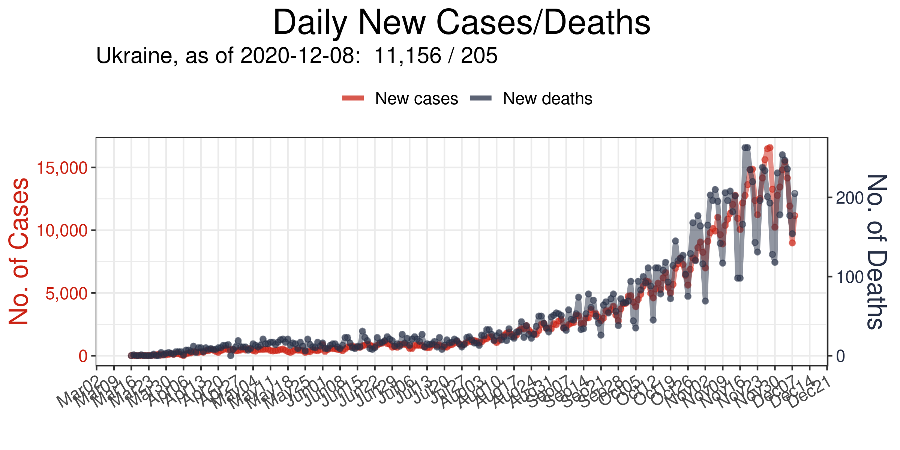
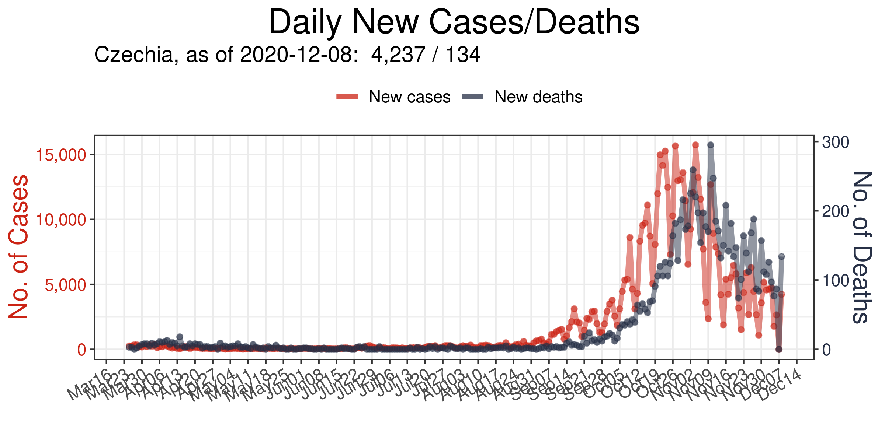
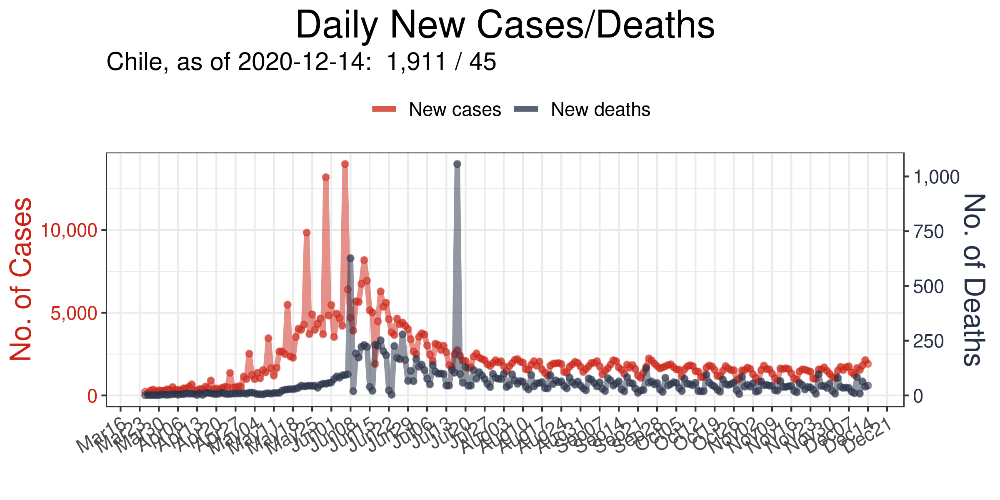
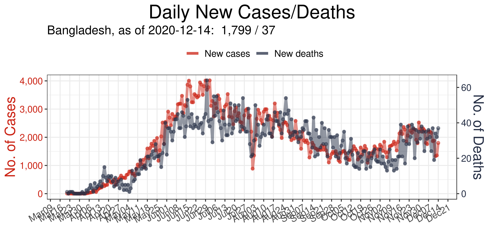
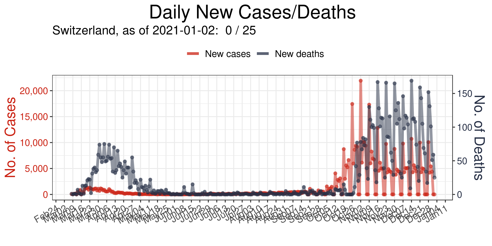
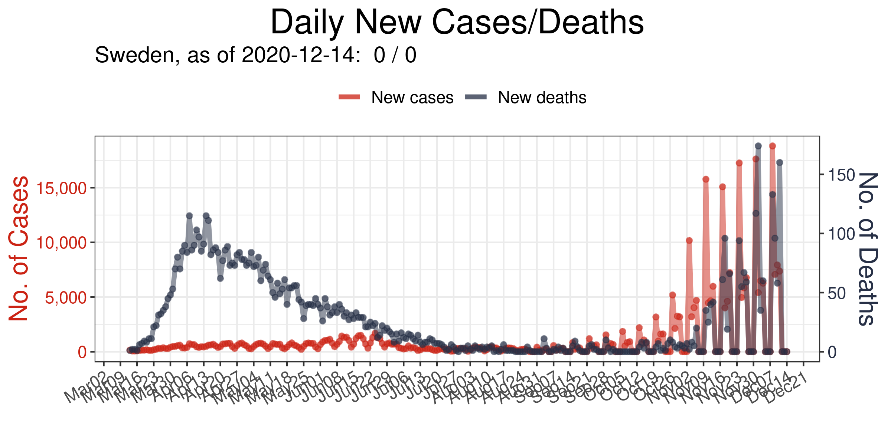
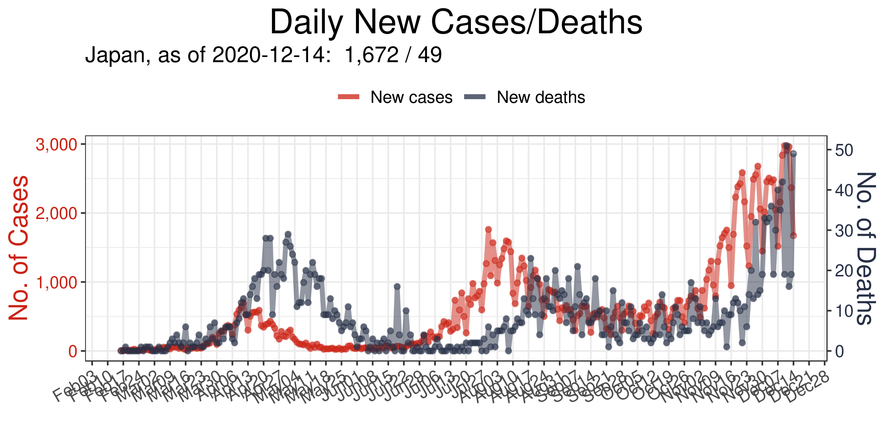
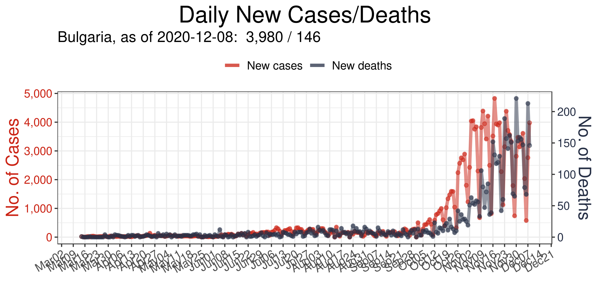

 
&nbsp;
 

 
&nbsp;
 

## 2020-12-28, COVID-19 Time Series
# Countries (top 50)

 
&nbsp;
 

|  1. US  |  2. India  |  
|  :---   |   :---   |  
|    |    |  

|  3. Brazil  |  4. Russia  |  
|  :---   |   :---   |  
|    |    |  

|  5. France  |  6. United Kingdom  |  
|  :---   |   :---   |  
|    |    |  

|  7. Turkey  |  8. Italy  |  
|  :---   |   :---   |  
|    |    |  

|  9. Spain  |  10. Germany  |  
|  :---   |   :---   |  
|    |    |  

|  11. Colombia  |  12. Argentina  |  
|  :---   |   :---   |  
|    |    |  

|  13. Mexico  |  14. Poland  |  
|  :---   |   :---   |  
|    |    |  

|  15. Iran  |  16. Ukraine  |  
|  :---   |   :---   |  
|    |    |  

|  17. South Africa  |  18. Peru  |  
|  :---   |   :---   |  
|    |    |  

|  19. Netherlands  |  20. Indonesia  |  
|  :---   |   :---   |  
|    |    |  

|  21. Czechia  |  22. Belgium  |  
|  :---   |   :---   |  
|    |    |  

|  23. Romania  |  24. Chile  |  
|  :---   |   :---   |  
|    |    |  

|  25. Iraq  |  26. Canada  |  
|  :---   |   :---   |  
|    |    |  

|  27. Bangladesh  |  28. Pakistan  |  
|  :---   |   :---   |  
|    |    |  

|  29. Philippines  |  30. Switzerland  |  
|  :---   |   :---   |  
|    |    |  

|  31. Morocco  |  32. Israel  |  
|  :---   |   :---   |  
|    |    |  

|  33. Portugal  |  34. Sweden  |  
|  :---   |   :---   |  
|    |    |  

|  35. Saudi Arabia  |  36. Austria  |  
|  :---   |   :---   |  
|    |    |  

|  37. Serbia  |  38. Hungary  |  
|  :---   |   :---   |  
|    |    |  

|  39. Jordan  |  40. Nepal  |  
|  :---   |   :---   |  
|    |    |  

|  41. Panama  |  42. Japan  |  
|  :---   |   :---   |  
|    |    |  

|  43. Georgia  |  44. Azerbaijan  |  
|  :---   |   :---   |  
|    |    |  

|  45. Ecuador  |  46. Croatia  |  
|  :---   |   :---   |  
|    |    |  

|  47. United Arab Emirates  |  48. Kazakhstan  |  
|  :---   |   :---   |  
|    |    |  

|  49. Bulgaria  |  50. Belarus  |  
|  :---   |   :---   |  
|    |    |  

Korea, South  
    

