 
&nbsp;
 

 
&nbsp;
 

## 2021-01-18, COVID-19 Time Series
# States in the U.S. 

 
&nbsp;
 

|  1. CA  |  2. TX  |  
|  :---   |   :---   |  
|  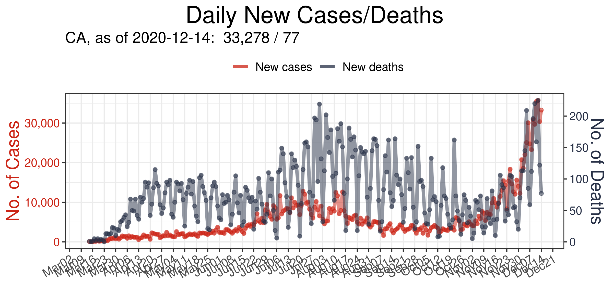  |    |  

|  3. FL  |  4. NY  |  
|  :---   |   :---   |  
|    |  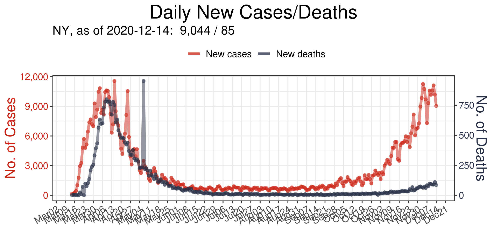  |  

|  5. IL  |  6. OH  |  
|  :---   |   :---   |  
|    |    |  

|  7. PA  |  8. TN  |  
|  :---   |   :---   |  
|    |    |  

|  9. GA  |  10. AZ  |  
|  :---   |   :---   |  
|    |  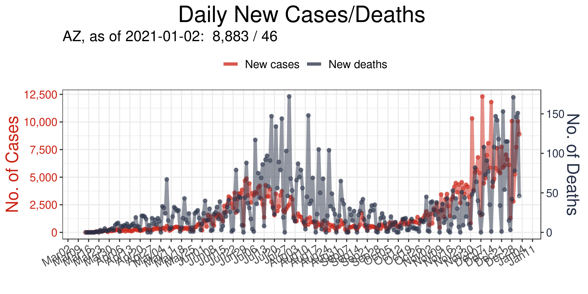  |  

|  11. NC  |  12. NJ  |  
|  :---   |   :---   |  
|    |    |  

|  13. IN  |  14. MI  |  
|  :---   |   :---   |  
|    |  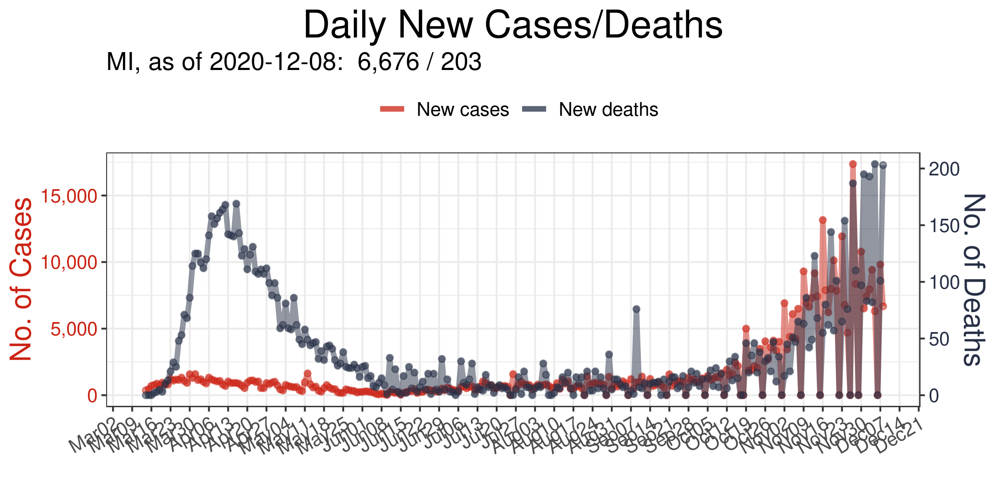  |  

|  15. WI  |  16. MA  |  
|  :---   |   :---   |  
|    |    |  

|  17. MN  |  18. VA  |  
|  :---   |   :---   |  
|  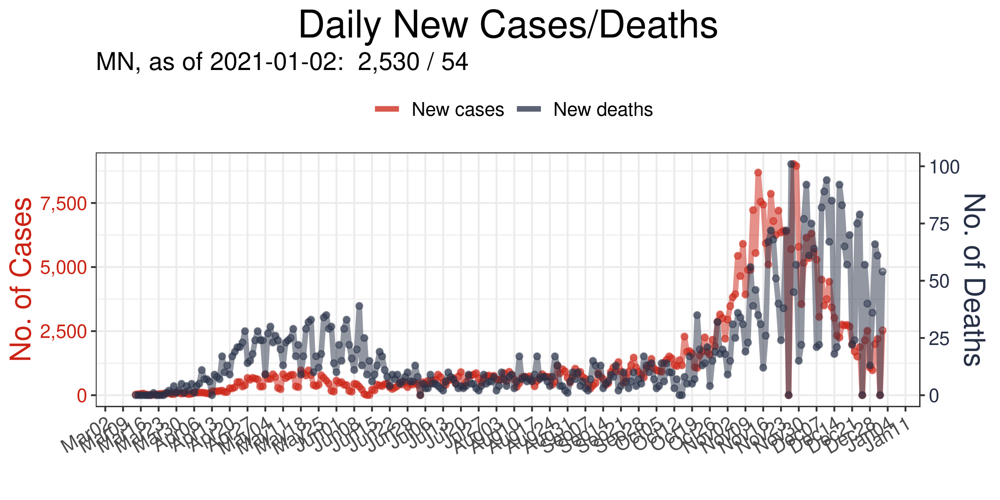  |    |  

|  19. MO  |  20. AL  |  
|  :---   |   :---   |  
|    |  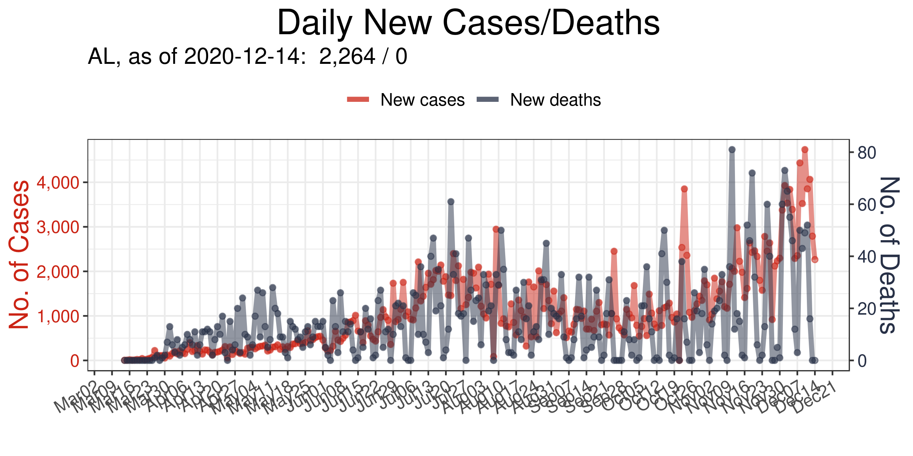  |  

|  21. SC  |  22. CO  |  
|  :---   |   :---   |  
|  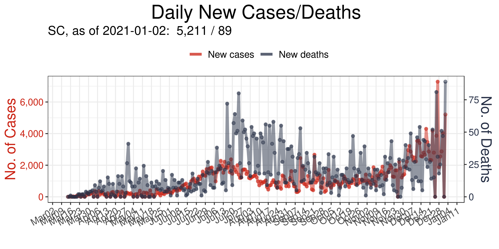  |    |  

|  23. LA  |  24. OK  |  
|  :---   |   :---   |  
|    |    |  

|  25. KY  |  26. MD  |  
|  :---   |   :---   |  
|  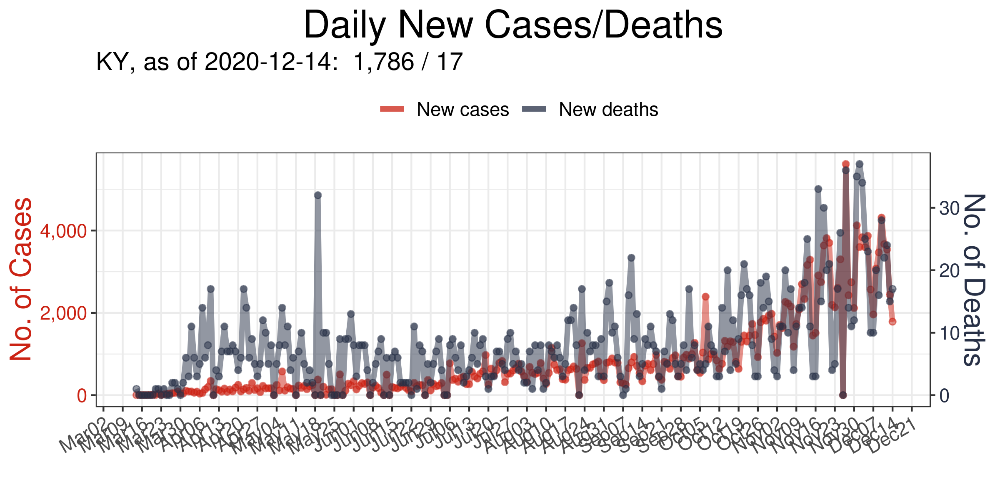  |  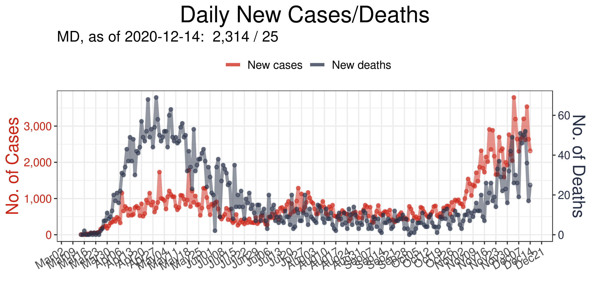  |  

|  27. UT  |  28. WA  |  
|  :---   |   :---   |  
|  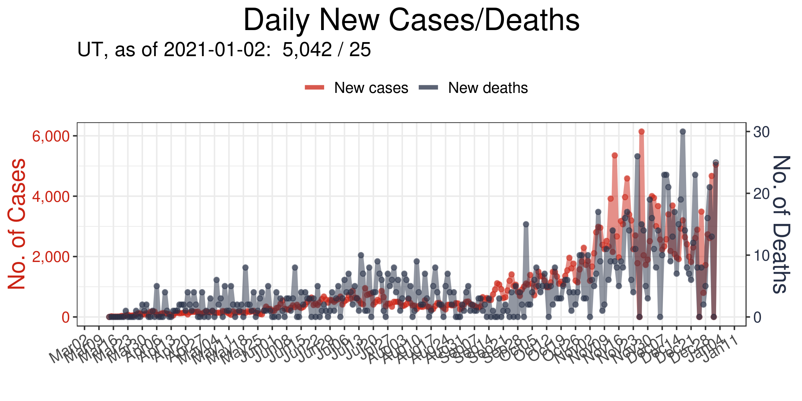  |    |  

|  29. AR  |  30. NV  |  
|  :---   |   :---   |  
|  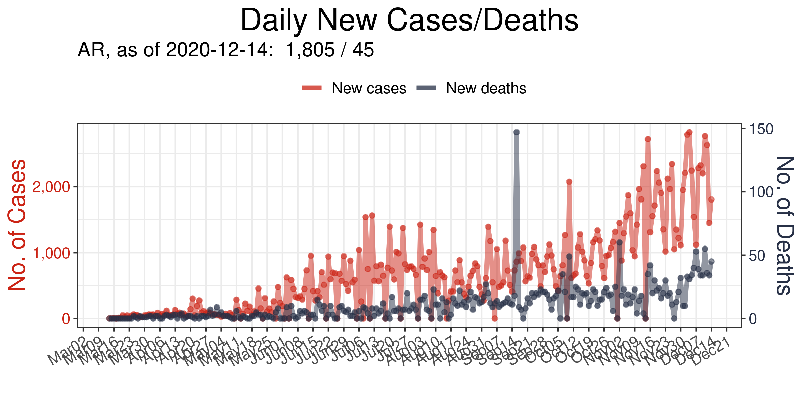  |    |  

|  31. KS  |  32. IA  |  
|  :---   |   :---   |  
|    |    |  

|  33. MS  |  34. CT  |  
|  :---   |   :---   |  
|  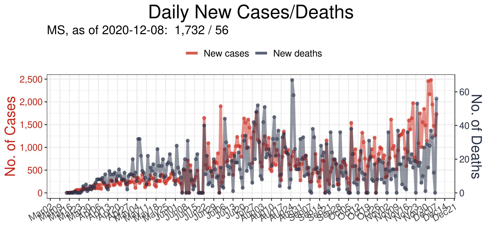  |  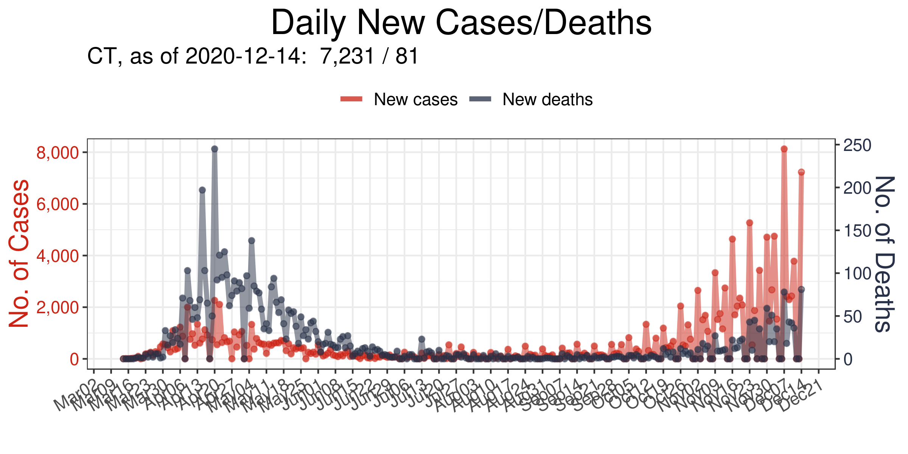  |  

|  35. NE  |  36. NM  |  
|  :---   |   :---   |  
|    |    |  

|  37. ID  |  38. OR  |  
|  :---   |   :---   |  
|    |    |  

|  39. WV  |  40. SD  |  
|  :---   |   :---   |  
|    |    |  

|  41. RI  |  42. ND  |  
|  :---   |   :---   |  
|    |    |  

|  43. MT  |  44. DE  |  
|  :---   |   :---   |  
|  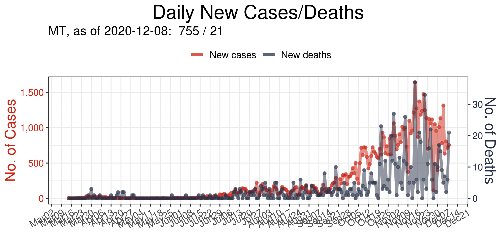  |  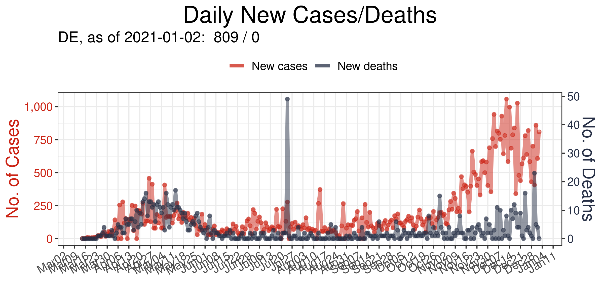  |  

|  45. NH  |  46. AK  |  
|  :---   |   :---   |  
|    |  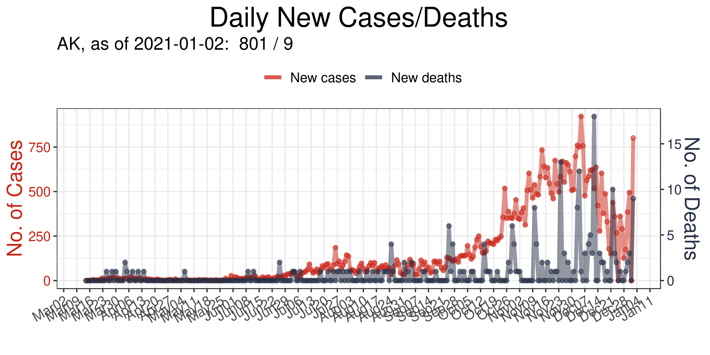  |  

|  47. WY  |  48. DC  |  
|  :---   |   :---   |  
|  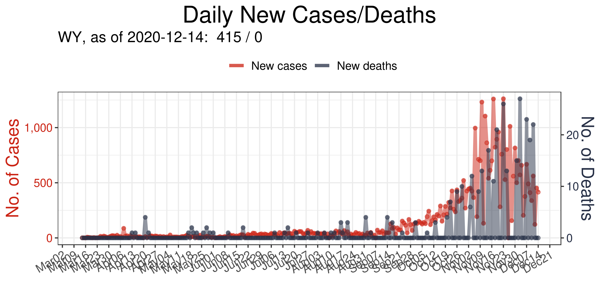  |    |  

|  49. ME  |  50. HI  |  
|  :---   |   :---   |  
|  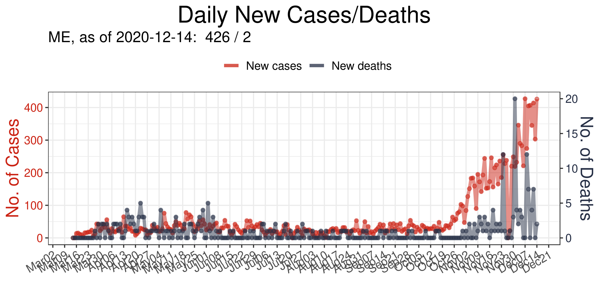  |    |  

|  51. VT  |  52. NA  |  
|  :---   |   :---   |  
|   |   NA  |  

